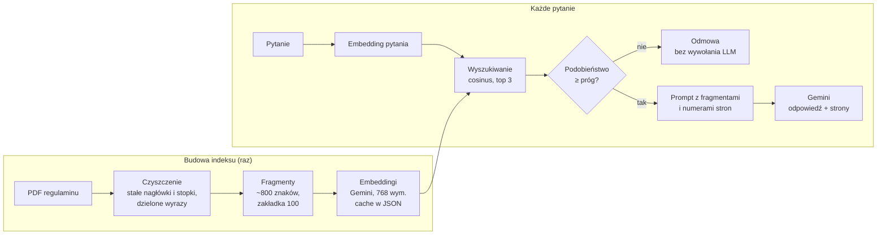

# BankRAG

**Asystent dla pracowników banku, który odpowiada na pytania o procedury i regulaminy na podstawie dokumentów, ze wskazaniem strony źródłowej. Gdy odpowiedzi w dokumentach nie ma, mówi „nie wiem” zamiast zgadywać.**

Projekt RAG (Retrieval-Augmented Generation) napisany od podstaw w Pythonie: własne czyszczenie PDF, dzielenie na fragmenty, wyszukiwanie wektorowe na `numpy` (bez gotowych frameworków typu LangChain czy baz wektorowych) i generowanie odpowiedzi przez Gemini API.

> Status: działa w wersji konsolowej (pytanie → odpowiedź ze stroną albo odmowa). W trakcie: interfejs Streamlit, ocena jakości (hit@k), wdrożenie na Google Cloud. Szczegóły w sekcji [Plan rozwoju](#plan-rozwoju).

---

## Problem biznesowy

Pracownik oddziału, który dostaje od klienta pytanie typu „ile muszę mieć wpływów, żeby nie płacić za konto?” albo „kto może dysponować pieniędzmi na rachunku?”, musi znaleźć odpowiedź w regulaminie liczącym kilkadziesiąt stron. To trwa, a odpowiedź z pamięci bywa nieprecyzyjna.

BankRAG skraca to do jednego pytania i, co w banku najważniejsze, **każdą odpowiedź opatruje numerem strony**, żeby pracownik mógł ją zweryfikować w dokumencie.

## Jak to działa



1. **Czyszczenie PDF** (`czyszczenie_pdf.py`): tekst z każdej strony, usunięcie linii powtarzających się na brzegach stron (nagłówki, stopki, numery stron), sklejenie wyrazów dzielonych na końcu linii, uporządkowanie białych znaków.
2. **Podział na fragmenty** (`podziel_fragmenty.py`): fragmenty do 800 znaków z zakładką 100 znaków, cięte na spacjach, osobno dla każdej strony, żeby każdy fragment miał jednoznaczny numer strony.
3. **Embeddingi** (`embedding.py`): każdy fragment zamieniany na wektor 768 liczb (`gemini-embedding-001`, `RETRIEVAL_DOCUMENT`), liczony paczkami i zapisywany w cache po każdej paczce.
4. **Wyszukiwanie** (`embedding.py`): wektory znormalizowane do długości 1, więc podobieństwo cosinusowe to zwykły iloczyn skalarny. Podobieństwo pytania do wszystkich fragmentów liczy jedno mnożenie macierzy przez wektor.
5. **Odpowiedź** (`asystent.py`): 3 najlepsze fragmenty powyżej progu trafiają do promptu razem z numerami stron, Gemini odpowiada wyłącznie na ich podstawie.

## Ochrona przed halucynacjami

W kontekście bankowym błędna, ale pewnie brzmiąca odpowiedź jest gorsza niż brak odpowiedzi. Dlatego są dwie niezależne blokady:

| blokada | gdzie | kiedy działa |
|---|---|---|
| **Próg podobieństwa** | kod (`PROG`) | pytanie nie pasuje do żadnego fragmentu (np. „jaka jest pogoda?”). Odmowa zapada w kodzie, **model językowy nie jest w ogóle wywoływany** |
| **Instrukcja systemowa** | prompt | fragmenty są na temat, ale nie zawierają odpowiedzi. Model ma odpowiedzieć ustalonym tekstem odmowy |

Dodatkowo: niska temperatura generowania (0.1) i obowiązkowe numery stron przy każdej informacji.

## Struktura projektu

```
BankRAG/
├── czyszczenie_pdf.py        # etap 1: PDF → oczyszczony tekst stron
├── podziel_fragmenty.py      # etap 2: strony → fragmenty.json
├── embedding.py              # etap 3: fragmenty → embeddingi.json + wyszukiwanie
├── asystent.py               # etap 4: pytanie → odpowiedź ze źródłem lub odmowa
├── testy/
│   ├── testy_czyszczenie.py  # testy etapu 1
│   ├── testy_fragmenty.py    # testy etapu 2
│   └── testy_embedding.py    # testy wyszukiwania (numpy)
├── sprawdz_asystenta.py      # ręczna kontrola asystenta na prawdziwym API (6 pytań)
├── 01_models.py              # lista modeli dostępnych dla klucza API
├── dane/
│   └── decyzje_i_ryzyka.md   # dziennik decyzji, testów i ryzyk
├── requirements.txt
├── .env                      # klucz API (nie w repozytorium)
└── README.md
```

Pliki generowane (`fragmenty.json`, `embeddingi.json`) i sam PDF nie są w repozytorium. Odtwarza się je poleceniami z sekcji [Uruchomienie](#uruchomienie).

## Uruchomienie

**Wymagania:** Python 3.11+ i klucz Gemini API ([Google AI Studio](https://aistudio.google.com/)).

```bash
git clone <adres-repozytorium>
cd BankRAG
python -m venv .venv
.venv\Scripts\activate            # Windows
# source .venv/bin/activate       # Linux / macOS
pip install -r requirements.txt
```

Plik `.env` w katalogu projektu:
```
GEMINI_API_KEY=twoj_klucz
```

Dokument źródłowy: pobierz regulamin `Regulamin-kont-dla-klientow-indywidualnych-od-06.07.2026.pdf` ze strony banku (<!-- TODO: link do źródła i data pobrania -->) i umieść go w katalogu projektu.

**Budowa indeksu (raz):**
```bash
python podziel_fragmenty.py     # PDF → fragmenty.json (+ statystyki i 5 losowych fragmentów)
python embedding.py             # fragmenty.json → embeddingi.json (+ przykładowe wyszukiwanie)
```
Liczenie embeddingów jest wznawialne: przy przerwaniu (np. limit API) kolejne uruchomienie dociąga tylko brakujące fragmenty.

**Asystent:**
```bash
python asystent.py
```
```
Pytanie: Kto może dysponować pieniędzmi na koncie?
<odpowiedź modelu z numerami stron>
Źródła: strony ...
Podobieństwa: [...]
```
Pusta linia kończy program.

**Interfejs Streamlit:**
```bash
streamlit run app.py
```
Czat w przeglądarce (http://localhost:8501): odpowiedź z numerami stron, podgląd znalezionych fragmentów z podobieństwami, a w panelu bocznym suwaki progu i top-k.

## Testy

```bash
python testy/testy_czyszczenie.py
python testy/testy_fragmenty.py
python testy/testy_embedding.py
```
Testy nie wymagają klucza API ani internetu. Warstwa API jest oddzielona od logiki: funkcje przyjmują funkcję embeddingu i generowania jako parametr, więc w testach podstawiane są atrapy zamiast prawdziwego Gemini.

Co sprawdzają m.in.:
- usuwanie stałych linii tylko ze strefy brzegowej strony, sklejanie dzielonych wyrazów,
- normalizację wektorów (długość 1, błąd dla wektora zerowego),
- poprawność rankingu wyszukiwania i niezależność od skali wektora pytania.

## Kluczowe decyzje techniczne

| decyzja | uzasadnienie |
|---|---|
| Wyszukiwanie na `numpy` zamiast bazy wektorowej | przy ~200 fragmentach mnożenie macierzy 178×768 przez wektor trwa ułamek milisekundy; baza wektorowa byłaby dodatkową zależnością bez zysku. Własna implementacja pozwala też dokładnie wyjaśnić każdy krok |
| Fragmenty 800 znaków, zakładka 100 | fragment mieści zwykle 1–2 punkty regulaminu; zakładka chroni zdania przecięte na granicy fragmentów |
| Cięcie w obrębie strony | każdy fragment ma jeden numer strony, więc źródło w odpowiedzi jest jednoznaczne |
| Normalizacja wektorów | cosinus staje się iloczynem skalarnym, cały ranking to jedno `macierz @ wektor`. Dla wymiaru 768 model nie zwraca wektorów znormalizowanych |
| `RETRIEVAL_DOCUMENT` / `RETRIEVAL_QUERY` | osobne typy zadań dla fragmentów i pytań; model ustawia wektory tak, by pytanie było blisko pasującej odpowiedzi |
| Cache embeddingów z zapisem po każdej paczce | darmowy plan ma limit 100 zapytań do embeddingów na minutę; paczki po 20 z przerwą 15 s mieszczą się w limicie, a przerwanie nie traci postępu |
| Ponawianie tylko przy błędzie 503 | 503 (chwilowe przeciążenie) mija samo, ponawiane z rosnącą przerwą 1, 2, 4, 8 s. Inne błędy (np. 429, 400) są zgłaszane od razu, bo ponowienie nic by nie dało |
| Kontrola liczby wektorów w odpowiedzi API | niektóre modele dla listy tekstów zwracają jeden zagregowany wektor; bez kontroli fragmenty zostałyby po cichu pominięte |

Pełny dziennik decyzji, wyników testów i ryzyk: [`dane/decyzje_i_ryzyka.md`](dane/decyzje_i_ryzyka.md).

## Dane

| parametr | wartość |
|---|---|
| dokument | regulamin kont dla klientów indywidualnych (od 06.07.2026), 40 stron |
| liczba fragmentów | 178 |
| model embeddingów | `gemini-embedding-001`, 768 wymiarów |
| model generowania | `gemini-3.5-flash` |
| top-k / próg | 3 / 0.6 (próg tymczasowy, do kalibracji na zbiorze pytań testowych) |

## Ograniczenia i ryzyka

- **Liczby i przeczenia:** embeddingi słabo rozróżniają „powyżej 2000 zł” od „poniżej 2000 zł”. Wyszukiwanie znajdzie właściwy fragment, ale za poprawność warunku odpowiada model generujący, dlatego numery stron są obowiązkowe.
- **Jeden dokument:** indeks obejmuje obecnie jeden regulamin. Wiele dokumentów wymaga rozróżniania wersji i dat obowiązywania.
- **Próg odrzucania** jest na razie ustawiony ręcznie, a nie wyznaczony z pomiarów.
- **Dane osobowe (RODO):** asystent jest przeznaczony do pytań o procedury, a nie o konkretnych klientów. Pytania nie powinny zawierać danych klientów, bo trafiają do zewnętrznego API. W środowisku produkcyjnym: Vertex AI w regionie UE, logowanie i kontrola dostępu.
- **AI Act:** system wspiera pracownika, a nie podejmuje decyzji wobec klienta. Odpowiedź zawsze wymaga weryfikacji w źródle przez człowieka.
- **Darmowy plan API:** limity na minutę i na dzień. W produkcji płatny plan lub Vertex AI.

## Plan rozwoju

- [x] Czyszczenie PDF i podział na fragmenty z numerami stron
- [x] Embeddingi z cache i obsługą limitów API
- [x] Wyszukiwanie wektorowe na `numpy`
- [x] Asystent z odpowiedzią ze źródłem i odmową poniżej progu
- [x] Interfejs Streamlit
- [ ] Zbiór 15–20 pytań testowych, miary hit@1 / hit@3 / hit@5, kalibracja progu
- [ ] Testy asystenta: pytania spoza dokumentu, z fałszywym założeniem, z liczbami
- [ ] Przejście na Vertex AI (Google Cloud) i wdrożenie na Cloud Run
- [ ] Dokumentacja biznesowa: mapa procesu as-is / to-be, metryki sukcesu

## Technologie

Python · NumPy · pypdf · google-genai (Gemini API) · python-dotenv

## Autor

<!-- TODO: imię i nazwisko, link do LinkedIn -->
