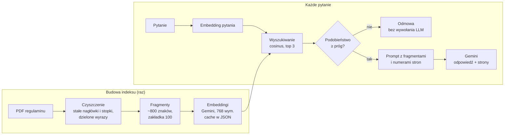

# BankRAG

**Asystent dla pracowników banku, który odpowiada na pytania o procedury i regulaminy na podstawie dokumentów, ze wskazaniem strony źródłowej. Gdy odpowiedzi w dokumentach nie ma, mówi „nie wiem” zamiast zgadywać.**

Projekt RAG (Retrieval-Augmented Generation) napisany od podstaw w Pythonie: własne czyszczenie PDF, dzielenie na fragmenty, wyszukiwanie wektorowe na `numpy` (bez gotowych frameworków typu LangChain czy baz wektorowych) i generowanie odpowiedzi przez Gemini API.

> Status: działa w wersji konsolowej i w przeglądarce (Streamlit). Jakość wyszukiwania zmierzona na 20 pytaniach (hit@3 = 100%), próg odmowy skalibrowany. Wdrożony na Cloud Run z Vertex AI (region UE, dostęp tylko po zalogowaniu). Szczegóły w sekcji [Plan rozwoju](#plan-rozwoju).

---

## Problem biznesowy

Pracownik oddziału, który dostaje od klienta pytanie typu „ile muszę mieć wpływów, żeby nie płacić za konto?” albo „kto może dysponować pieniędzmi na rachunku?”, musi znaleźć odpowiedź w regulaminie liczącym kilkadziesiąt stron. To trwa, a odpowiedź z pamięci bywa nieprecyzyjna.

BankRAG skraca to do jednego pytania i, co w banku najważniejsze, **każdą odpowiedź opatruje numerem strony**, żeby pracownik mógł ją zweryfikować w dokumencie.

## Jak to działa



1. **Czyszczenie PDF** (`czyszczenie_pdf.py`): tekst z każdej strony, usunięcie linii powtarzających się na brzegach stron (nagłówki, stopki, numery stron), sklejenie wyrazów dzielonych na końcu linii, uporządkowanie białych znaków.
2. **Podział na fragmenty** (`podziel_fragmenty.py`): fragmenty do 800 znaków z zakładką 100 znaków, cięte na spacjach, osobno dla każdej strony, żeby każdy fragment miał jednoznaczny numer strony.
3. **Embeddingi** (`embedding.py`): każdy fragment zamieniany na wektor 768 liczb (`gemini-embedding-001`, `RETRIEVAL_DOCUMENT`), liczony paczkami i zapisywany w cache po każdej paczce.
4. **Wyszukiwanie** (`embedding.py`): wektory znormalizowane do długości 1, więc podobieństwo cosinusowe to zwykły iloczyn skalarny. Podobieństwo pytania do wszystkich fragmentów liczy jedno mnożenie macierzy przez wektor.
5. **Odpowiedź** (`asystent.py`): 3 najlepsze fragmenty powyżej progu trafiają do promptu razem z numerami stron, Gemini odpowiada wyłącznie na ich podstawie.

## Ochrona przed halucynacjami

W kontekście bankowym błędna, ale pewnie brzmiąca odpowiedź jest gorsza niż brak odpowiedzi. Dlatego są dwie niezależne blokady:

| blokada | gdzie | kiedy działa |
|---|---|---|
| **Próg podobieństwa** | kod (`PROG`) | pytanie nie pasuje do żadnego fragmentu (np. „jaka jest pogoda?”). Odmowa zapada w kodzie, **model językowy nie jest w ogóle wywoływany** |
| **Instrukcja systemowa** | prompt | fragmenty są na temat, ale nie zawierają odpowiedzi. Model ma odpowiedzieć ustalonym tekstem odmowy |

Dodatkowo: niska temperatura generowania (0.1) i obowiązkowe numery stron przy każdej informacji.

## Struktura projektu

```
BankRAG/
├── czyszczenie_pdf.py        # etap 1: PDF → oczyszczony tekst stron
├── podziel_fragmenty.py      # etap 2: strony → fragmenty.json
├── embedding.py              # etap 3: fragmenty → embeddingi.json + wyszukiwanie
├── asystent.py               # etap 4: pytanie → odpowiedź ze źródłem lub odmowa
├── app.py                    # interfejs Streamlit (czat w przeglądarce)
├── testy/
│   ├── uruchom_testy.py      # uruchamia wszystkie testy po kolei
│   ├── testy_czyszczenie.py  # testy etapu 1
│   ├── testy_fragmenty.py    # testy etapu 2
│   ├── testy_embedding.py    # testy wyszukiwania (numpy)
│   ├── testy_asystent.py     # testy asystenta z atrapami zamiast Gemini
│   └── testy_ocena.py        # testy miar hit@k, progu i zbioru pytań
├── sprawdz_asystenta.py      # ręczna kontrola asystenta na prawdziwym API (13 pytań)
├── ocena.py                  # hit@1/3/5 i kalibracja progu na zbiorze pytań
├── pytania_testowe.json      # zbiór pytań testowych z poprawnymi stronami
├── dokumenty/                # mapa procesu, program ambasadorów, scenariusz wywiadu
├── dane/
│   ├── decyzje_i_ryzyka.md   # dziennik decyzji, testów i ryzyk
│   ├── ocena_wyszukiwania.json  # wynik ostatniego uruchomienia ocena.py
│   └── sprawdzenie_*.json    # wyniki sprawdz_asystenta.py
├── Dockerfile                # obraz dla Cloud Run
├── .gcloudignore             # co nie trafia do Cloud Build (patrz niżej)
├── requirements.txt
├── .env                      # klucz API (nie w repozytorium)
└── README.md
```

Pliki generowane (`fragmenty.json`, `embeddingi.json`) i sam PDF nie są w repozytorium. Odtwarza się je poleceniami z sekcji [Uruchomienie](#uruchomienie).

## Uruchomienie

**Wymagania:** Python 3.11+ i klucz Gemini API ([Google AI Studio](https://aistudio.google.com/)).

```bash
git clone <adres-repozytorium>
cd BankRAG
python -m venv .venv
.venv\Scripts\activate            # Windows
# source .venv/bin/activate       # Linux / macOS
pip install -r requirements.txt
```

Plik `.env` w katalogu projektu:
```
GEMINI_API_KEY=twoj_klucz
```

Dokument źródłowy: pobierz regulamin `Regulamin-kont-dla-klientow-indywidualnych-od-06.07.2026.pdf` ze strony banku ([link](https://www.pgbs.pobiedziska.sgb.pl/wp-content/uploads/2026/05/Regulamin-kont-dla-klientow-indywidualnych-od-06.07.2026.pdf), pobrany 21.10.2026) i umieść go w katalogu projektu.

**Budowa indeksu (raz):**
```bash
python podziel_fragmenty.py     # PDF → fragmenty.json (+ statystyki i 5 losowych fragmentów)
python embedding.py             # fragmenty.json → embeddingi.json (+ przykładowe wyszukiwanie)
```
Liczenie embeddingów jest wznawialne: przy przerwaniu (np. limit API) kolejne uruchomienie dociąga tylko brakujące fragmenty.

**Asystent:**
```bash
python asystent.py
```
```
Pytanie: Kto może dysponować pieniędzmi na koncie?
<odpowiedź modelu z numerami stron>
Źródła: strony ...
Podobieństwa: [...]
```
Pusta linia kończy program.

**Interfejs Streamlit:**
```bash
streamlit run app.py
```
Czat w przeglądarce (http://localhost:8501): odpowiedź z numerami stron, podgląd znalezionych fragmentów z podobieństwami, a w panelu bocznym suwaki progu i top-k.

## Testy

```bash
python testy/uruchom_testy.py
```
Uruchamia wszystkie pliki `testy/testy_*.py` (każdy można też odpalić osobno). Testy nie wymagają klucza API ani internetu. Warstwa API jest oddzielona od logiki: funkcje przyjmują funkcję embeddingu i generowania jako parametr, więc w testach podstawiane są atrapy zamiast prawdziwego Gemini.

Co sprawdzają m.in.:
- usuwanie stałych linii tylko ze strefy brzegowej strony, sklejanie dzielonych wyrazów,
- normalizację wektorów (długość 1, błąd dla wektora zerowego),
- poprawność rankingu wyszukiwania i niezależność od skali wektora pytania,
- asystenta: poniżej progu odmowa **bez wywołania modelu**, do promptu trafiają tylko fragmenty powyżej progu, przy odmowie modelu brak źródeł,
- miary hit@k, kalibrację progu oraz to, że każde pytanie testowe z dokumentu ma wpisane strony.

## Ocena jakości

**Wyszukiwanie** (`python ocena.py`, 20 pytań z `pytania_testowe.json`: 15 z dokumentu, 5 spoza, wynik w `dane/ocena_wyszukiwania.json`):

| miara | wynik |
|---|---|
| hit@1 (poprawna strona na 1. miejscu) | 86,7% (13/15) |
| hit@3 (poprawna strona w top 3, tyle trafia do modelu) | 100% (15/15) |
| hit@5 | 100% |

Oba pudła na 1. miejscu to parafrazy (pytania 6 i 7): poprawna strona była na 3. miejscu. Uwaga: miara liczy trafienie strony, nie fragmentu (patrz [Ograniczenia](#ograniczenia-i-ryzyka)).

**Kalibracja progu:**

| grupa pytań | najlepsze podobieństwo |
|---|---|
| z dokumentu | min 0,693, średnio 0,760 |
| spoza, nie na temat (pogoda, bitcoin, rosół) | max 0,619 |
| spoza, ale bankowe (kredyt hipoteczny, utrata karty*) | 0,672 i 0,699 |

Pytania bankowe spoza regulaminu nachodzą na pytania z dokumentu, więc żaden próg nie rozdzieli ich bezbłędnie. Wybrany próg **0,65**: odcina wszystkie pytania nie na temat i nie odrzuca żadnego pytania z dokumentu. Pytania bankowe spoza zakresu przechodzą do modelu i tam zatrzymuje je druga blokada (instrukcja systemowa).

\* procedura zastrzegania karty jest w załączniku nr 2 do regulaminu, którego nie ma w indeksowanym PDF.

**Odpowiedzi asystenta** (`python sprawdz_asystenta.py`, 13 pytań na prawdziwym API, w tym liczby, fałszywe założenia i próby ataku): w ostatniej pełnej serii 11 z 12 zachowań zgodnych z oczekiwaniami, jedna zbyt ostrożna odmowa spowodowana wyszukiwaniem (opis w [Ograniczeniach](#ograniczenia-i-ryzyka)). Szczegóły w [`dane/decyzje_i_ryzyka.md`](dane/decyzje_i_ryzyka.md).

## Kluczowe decyzje techniczne

| decyzja | uzasadnienie |
|---|---|
| Wyszukiwanie na `numpy` zamiast bazy wektorowej | przy ~200 fragmentach mnożenie macierzy 178×768 przez wektor trwa ułamek milisekundy; baza wektorowa byłaby dodatkową zależnością bez zysku. Własna implementacja pozwala też dokładnie wyjaśnić każdy krok |
| Fragmenty 800 znaków, zakładka 100 | fragment mieści zwykle 1–2 punkty regulaminu; zakładka chroni zdania przecięte na granicy fragmentów |
| Cięcie w obrębie strony | każdy fragment ma jeden numer strony, więc źródło w odpowiedzi jest jednoznaczne |
| Normalizacja wektorów | cosinus staje się iloczynem skalarnym, cały ranking to jedno `macierz @ wektor`. Dla wymiaru 768 model nie zwraca wektorów znormalizowanych |
| `RETRIEVAL_DOCUMENT` / `RETRIEVAL_QUERY` | osobne typy zadań dla fragmentów i pytań; model ustawia wektory tak, by pytanie było blisko pasującej odpowiedzi |
| Cache embeddingów z zapisem po każdej paczce | darmowy plan ma limit 100 zapytań do embeddingów na minutę; paczki po 20 z przerwą 15 s mieszczą się w limicie, a przerwanie nie traci postępu |
| Ponawianie tylko przy błędzie 503 | 503 (chwilowe przeciążenie) mija samo, ponawiane z rosnącą przerwą 1, 2, 4, 8 s. Inne błędy (np. 429, 400) są zgłaszane od razu, bo ponowienie nic by nie dało |
| Kontrola liczby wektorów w odpowiedzi API | niektóre modele dla listy tekstów zwracają jeden zagregowany wektor; bez kontroli fragmenty zostałyby po cichu pominięte |

Pełny dziennik decyzji, wyników testów i ryzyk: [`dane/decyzje_i_ryzyka.md`](dane/decyzje_i_ryzyka.md).

## Dane

| parametr | wartość |
|---|---|
| dokument | regulamin kont dla klientów indywidualnych (od 06.07.2026), 40 stron |
| liczba fragmentów | 178 |
| model embeddingów | `gemini-embedding-001`, 768 wymiarów |
| model generowania | `gemini-3.5-flash` |
| top-k / próg | 3 / 0.65 (próg skalibrowany na zbiorze pytań testowych, patrz [Ocena jakości](#ocena-jakości)) |

## Ograniczenia i ryzyka

- **Liczby i przeczenia:** embeddingi słabo rozróżniają „powyżej 2000 zł” od „poniżej 2000 zł”. Wyszukiwanie znajdzie właściwy fragment, ale za poprawność warunku odpowiada model generujący, dlatego numery stron są obowiązkowe.
- **Jeden dokument:** indeks obejmuje obecnie jeden regulamin. Wiele dokumentów wymaga rozróżniania wersji i dat obowiązywania.
- **Próg odrzucania** wyznaczony na 20 pytaniach. To mała próba: pytania bankowe spoza regulaminu mają podobieństwo takie jak pytania z dokumentu, więc dla nich działa tylko druga blokada (instrukcja systemowa).
- **Inne słowa w pytaniu i w dokumencie:** na pytanie „Jak mogę wypowiedzieć umowę rachunku?” wyszukiwanie znajduje właściwą stronę (34), ale nie fragment z odpowiedzią, bo regulamin mówi o „umowie ramowej”. Model wtedy poprawnie odmawia. Możliwa poprawka: wyszukiwanie hybrydowe (słowa kluczowe + wektory) albo dopisanie nagłówka rozdziału do każdego fragmentu.
- **Ocena na poziomie stron:** hit@k sprawdza, czy znaleziono właściwą *stronę*, a nie właściwy *fragment*, więc trochę zawyża wynik (przykład wyżej liczy się jako trafienie).
- **Załączniki:** regulamin odsyła do załączników (np. nr 2 o kartach), których nie ma w indeksie.
- **Dane osobowe (RODO):** asystent jest przeznaczony do pytań o procedury, a nie o konkretnych klientów. Pytania nie powinny zawierać danych klientów, bo trafiają do zewnętrznego API. Wersja na Cloud Run używa Vertex AI w regionie UE (Frankfurt) i jest dostępna tylko po zalogowaniu.
- **AI Act:** system wspiera pracownika, a nie podejmuje decyzji wobec klienta. Odpowiedź zawsze wymaga weryfikacji w źródle przez człowieka.
- **Darmowy plan API (AI Studio):** limity na minutę i 20 zapytań do modelu dziennie. Na Vertex AI tego limitu nie ma, ale każde zapytanie kosztuje (grosze).

## Plan rozwoju

- [x] Czyszczenie PDF i podział na fragmenty z numerami stron
- [x] Embeddingi z cache i obsługą limitów API
- [x] Wyszukiwanie wektorowe na `numpy`
- [x] Asystent z odpowiedzią ze źródłem i odmową poniżej progu
- [x] Interfejs Streamlit
- [x] Zbiór 20 pytań testowych, miary hit@1 / hit@3 / hit@5, kalibracja progu
- [x] Testy asystenta: pytania spoza dokumentu, z fałszywym założeniem, z liczbami
- [x] Kod przygotowany pod Vertex AI i Cloud Run (`Dockerfile` sprawdzony lokalnie, przełącznik w `.env`)
- [x] Wdrożenie na Cloud Run (region `europe-west3`, dostęp tylko po zalogowaniu)
- [x] Dokumentacja biznesowa: mapa procesu as-is / to-be, metryki sukcesu (`dokumenty/`, szkic do weryfikacji)
- [ ] Więcej dokumentów (taryfa, załączniki do regulaminu) z datą obowiązywania przy każdym źródle

## Wdrożenie na Google Cloud (Vertex AI + Cloud Run)

Ten sam kod działa z Gemini API (klucz z AI Studio) albo z Vertex AI. Przełącznik w `.env` lub w zmiennych środowiskowych:
```
GOOGLE_GENAI_USE_VERTEXAI=true
GOOGLE_CLOUD_PROJECT=id-projektu
GOOGLE_CLOUD_LOCATION=europe-west3
```
Na Vertex AI nie ma klucza API: uwierzytelnia konto usługi (lokalnie `gcloud auth application-default login`), a dane zostają w wybranym regionie UE. Embeddingi są liczone tym samym modelem (`gemini-embedding-001`), więc gotowy `embeddingi.json` pasuje bez przeliczania (sprawdzone 29.10: te same podobieństwa co w AI Studio, np. 0.815 / 0.783 / 0.76 dla pytania „Kto może dysponować pieniędzmi na koncie?”).

Region `europe-west3` (Frankfurt), bo w `europe-central2` (Warszawa) nie ma `gemini-3.5-flash` (sprawdzone 29.10; w Warszawie jest tylko model embeddingów).

Na komputerze z antywirusem skanującym HTTPS `gcloud` może zgłaszać `CERTIFICATE_VERIFY_FAILED`. Pomaga wskazanie pliku z certyfikatami z Windows: `gcloud config set core/custom_ca_certs_file <ścieżka do pliku .pem>`.

Test obrazu lokalnie przed wdrożeniem (z kluczem z `.env`, aplikacja na http://localhost:8080):
```bash
docker build -t bankrag .
docker run --rm -p 8080:8080 --env-file .env bankrag
```
Obraz zawiera tylko kod i gotowy indeks, bez `.env` i PDF (sprawdzone 29.10).

Wdrożenie na Cloud Run (z katalogu projektu, po zbudowaniu indeksu):
```bash
gcloud run deploy bankrag --source . --region europe-west3 --no-allow-unauthenticated --set-env-vars GOOGLE_GENAI_USE_VERTEXAI=true,GOOGLE_CLOUD_PROJECT=id-projektu,GOOGLE_CLOUD_LOCATION=europe-west3
```
- `--no-allow-unauthenticated`: aplikacja nie jest publiczna, dostęp tylko dla zalogowanych kont z uprawnieniem.
- `.gcloudignore` jest potrzebny, bo bez niego `gcloud` użyłby `.gitignore` i nie wysłałby `fragmenty.json` i `embeddingi.json`. `.env` i PDF nie są wysyłane.
- Konto usługi Cloud Run potrzebuje roli `Vertex AI User`.

Otwieranie wdrożonej aplikacji (adres bez logowania zwraca 403, tunel `gcloud` loguje Twoim kontem):
```bash
gcloud run services proxy bankrag --region europe-west3
```
Potem http://localhost:8080 w przeglądarce. W PowerShellu zamiast `gcloud` wpisuj `gcloud.cmd`.

## Technologie

Python · NumPy · pypdf · google-genai (Gemini API / Vertex AI) · Streamlit · python-dotenv · Docker · Google Cloud Run

## Autor

Kacper Broniarczyk | LinkedIn: www.linkedin.com/in/kacper-broniarczyk-a83328284


Większość projektu (pipeline, ocena, dokumenty biznesowe, wdrożenie) zrobiłem sam. Przy obsłudze części bibliotek (google-genai, truststore) i konfiguracji gcloud pomagał mi Claude (Anthropic).
