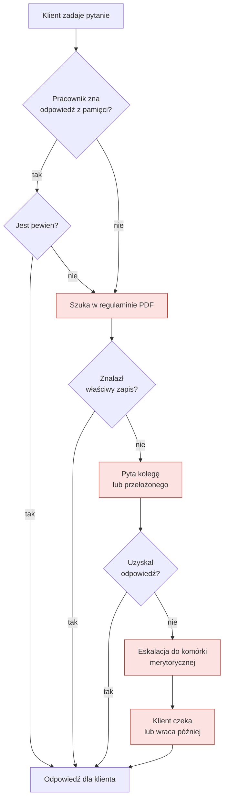
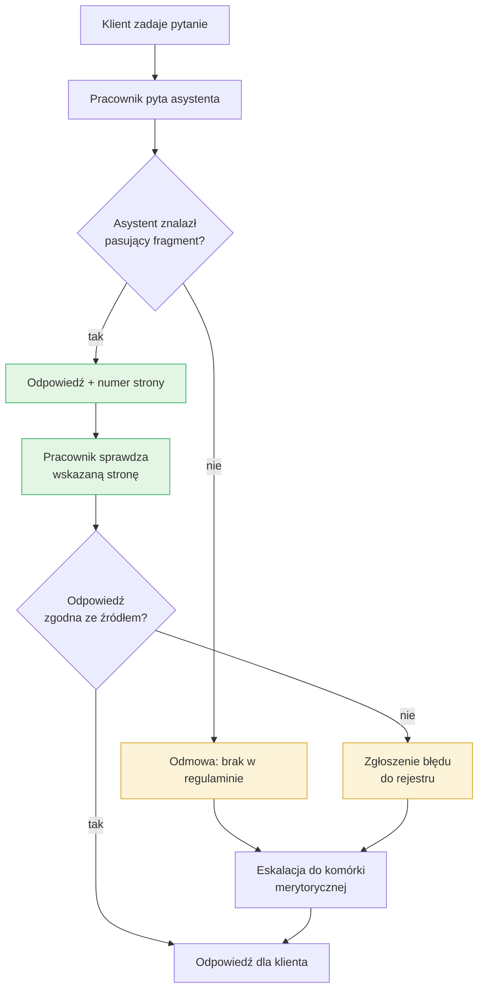

# Mapa procesu: odpowiedź na pytanie klienta o warunki rachunku

**Dokument roboczy (szkic).** Proces as-is opisany niżej jest **założeniem**, nie wynikiem obserwacji. Opiera się na typowym przebiegu obsługi w oddziale, a nie na danych z SGB. Przed użyciem w rozmowie o pracę zweryfikuj go — choćby w jednej rozmowie z osobą pracującą w banku — i zaznacz, co potwierdziłeś, a co nadal jest hipotezą. Liczby w tabeli „Czas i koszt” są **placeholderami do uzupełnienia**.

| | |
|---|---|
| Proces | Udzielenie klientowi odpowiedzi na pytanie o warunki prowadzenia rachunku |
| Właściciel procesu | *(do ustalenia: np. Departament Obsługi Klienta)* |
| Zakres | Od pytania klienta do udzielenia odpowiedzi. Bez reklamacji i spraw wymagających decyzji kredytowych |
| Wyzwalacz | Pytanie klienta (okienko, telefon, e-mail) |
| Rezultat | Odpowiedź zgodna z obowiązującym regulaminem |
| Uczestnicy | Pracownik pierwszej linii, bardziej doświadczony kolega lub przełożony, komórka merytoryczna |
| Dokumenty | Regulamin kont dla klientów indywidualnych, taryfa opłat, komunikaty o zmianach |

---

## 1. Stan obecny (as-is)

### Punkty bólu (hipotezy do weryfikacji w wywiadach)

| # | Punkt bólu | Skutek | Jak zweryfikować |
|---|---|---|---|
| P1 | Przeszukiwanie kilkudziesięciostronicowego PDF pod presją czasu | klient czeka, pracownik się stresuje | pytanie 4 i 5 ze scenariusza wywiadu |
| P2 | Odpowiedź „z pamięci” bez sprawdzenia w źródle | ryzyko nieaktualnej lub błędnej informacji | pytanie 3 i 6 |
| P3 | Pytanie kolegi odrywa dwie osoby od pracy | podwójny koszt czasu | pytanie 5 |
| P4 | Eskalacja do komórki merytorycznej | odpowiedź w kolejnych dniach, klient wraca | pytanie 7 |
| P5 | Zmiany w regulaminie nie zawsze docierają do wszystkich | różne odpowiedzi w różnych oddziałach | pytanie 8 |
| P6 | Brak śladu, skąd wzięła się odpowiedź | trudna weryfikacja przy reklamacji | pytanie 9 |

---

## 2. Stan docelowy (to-be)

### Co się zmienia

| element | as-is | to-be |
|---|---|---|
| Szukanie w dokumencie | ręczne przeglądanie PDF | pytanie w języku naturalnym |
| Źródło odpowiedzi | pamięć lub znaleziony zapis | fragment regulaminu z numerem strony |
| Weryfikacja | opcjonalna, zależna od pracownika | wbudowana w proces (krok „sprawdź stronę”) |
| Brak odpowiedzi | nieodróżnialny od złej odpowiedzi | jawna odmowa, która uruchamia eskalację |
| Aktualizacja wiedzy | zależna od przepływu komunikatów | jedno ponowne zbudowanie indeksu |
| Ślad decyzji | brak | wskazana strona, opcjonalnie log pytań |

### Czego to NIE zmienia (ważne, powiedz o tym wprost)

- **Decyzję podejmuje człowiek.** Asystent proponuje odpowiedź i źródło, nie zastępuje pracownika.
- **Krok weryfikacji zostaje.** Pominięcie go jest głównym ryzykiem procesu to-be, nie usprawnieniem.
- **Eskalacja zostaje.** Zmienia się tylko to, że uruchamia ją jawna odmowa, a nie brak pewności pracownika.

---

## 3. Czas i koszt (do uzupełnienia danymi z pilotażu)

Nie wpisuj tu liczb, których nie zmierzyłeś. Tabela służy do pokazania, **co** byś mierzył.

| miara | as-is | to-be | jak zmierzyć |
|---|---|---|---|
| Średni czas do odpowiedzi | ? | ? | pomiar na próbce pytań, przed i po |
| Odsetek pytań wymagających eskalacji | ? | ? | rejestr eskalacji |
| Odsetek odpowiedzi z podanym źródłem | ? (blisko 0) | ? | próbka kontrolna |
| Odsetek odpowiedzi niezgodnych z regulaminem | ? | ? | audyt próbki przez komórkę merytoryczną |
| Czas drugiej osoby zużyty na pomoc | ? | ? | wywiady, obserwacja |

---

## 4. Ryzyka wdrożenia

| ryzyko | skutek | ograniczanie |
|---|---|---|
| Pracownik ufa odpowiedzi bez sprawdzenia strony | błędna informacja dla klienta | szkolenie, interfejs pokazujący fragment źródłowy obok odpowiedzi, audyt próbki |
| Asystent odpowiada na podstawie nieaktualnej wersji regulaminu | odpowiedź formalnie błędna | data wersji widoczna w interfejsie, procedura odświeżania indeksu przy każdej zmianie |
| Pracownik wpisuje dane klienta w pytanie | przekazanie danych osobowych do zewnętrznej usługi | zasada „pytaj o procedurę, nie o klienta”, komunikat w interfejsie, w produkcji usługa w regionie UE |
| Pytania spoza zakresu dokumentu | fałszywe poczucie kompletności | jawna odmowa, jasno zakomunikowany zakres (jeden regulamin) |
| Spadek kompetencji pracowników | uzależnienie od narzędzia | asystent jako wsparcie, nie zamiennik szkoleń |

---

## 5. Zakres pilotażu (propozycja)

| | |
|---|---|
| Czas | 4 tygodnie |
| Zakres dokumentów | jeden regulamin kont dla klientów indywidualnych |
| Uczestnicy | *(do ustalenia: np. 5–8 pracowników z 2 oddziałów)* |
| Kryterium sukcesu | *(do ustalenia po pierwszych pomiarach, np. trafność wyszukiwania na poziomie ustalonym w ocenie oraz brak odpowiedzi niezgodnych z regulaminem w audycie próbki)* |
| Punkt odniesienia (prototyp, 29.10) | wyszukiwanie: hit@1 = 86,7%, hit@3 = 100% na 15 pytaniach z regulaminu; wszystkie 3 pytania nie na temat odrzucone progiem (szczegóły: `dane/ocena_wyszukiwania.json`). Mała próba, pytania pisane przez autora, a nie przez pracowników |
| Decyzja po pilotażu | rozszerzyć zakres dokumentów / poprawić / zatrzymać |

---

## 6. Co trzeba uzupełnić przed pokazaniem tego dokumentu

- [ ] zweryfikować proces as-is w rozmowie z osobą z banku i oznaczyć, co potwierdzone
- [ ] wpisać właściciela procesu i uczestników pilotażu
- [ ] uzupełnić miary po pierwszych pomiarach
- [x] dodać wyniki oceny wyszukiwania (hit@k) jako punkt odniesienia dla kryterium sukcesu
